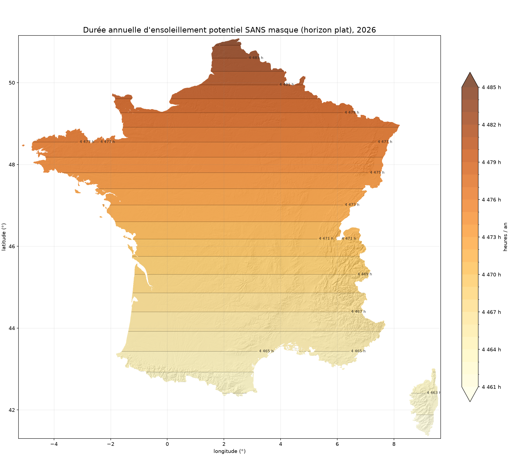
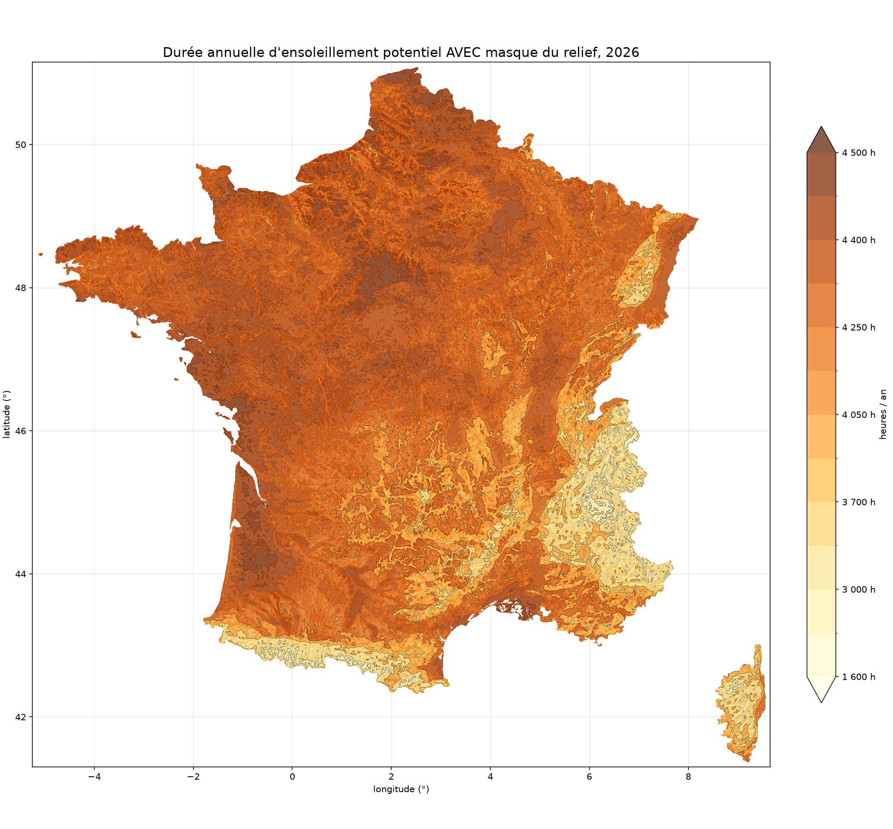
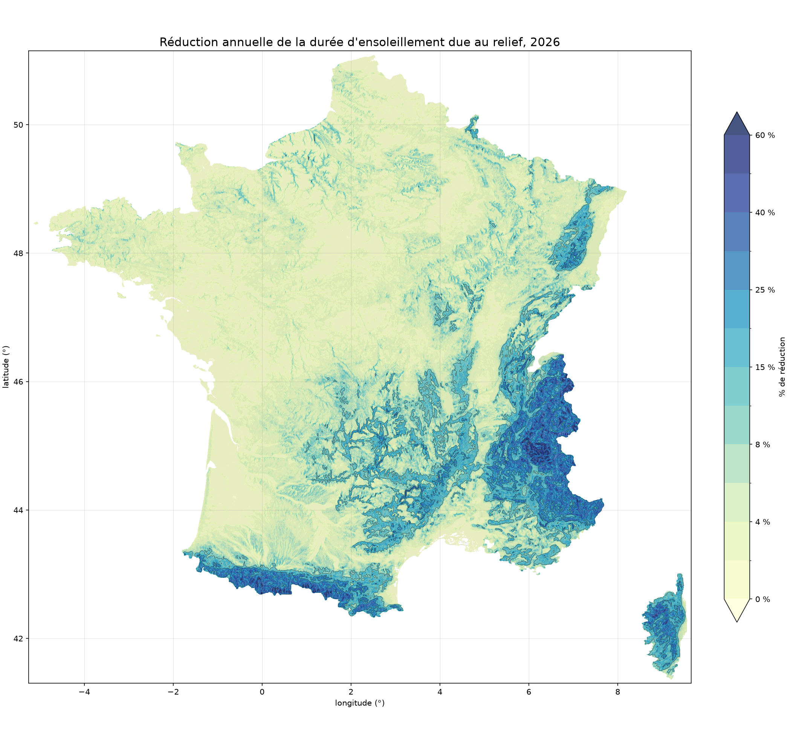

# Durée du jour réelle (masque du relief)

Calcule, à environ 90 m de résolution, la **durée pendant laquelle le Soleil est
visible** en tenant compte du relief, et la compare à la durée astronomique du jour
(horizon plat). Il s'agit d'un ensoleillement **potentiel** : la nébulosité n'est
pas prise en compte.

Deux modes :

- **Carte** : sur la France métropolitaine (par défaut) ou une zone `--bbox`, pour une
  ou plusieurs dates, ou en cumul annuel.
- **Point** : horizon détaillé en un lieu, avec les heures de lever et de coucher
  réelles jour par jour sur une année.

## Résultats : France, cumul annuel 2026

Cumul calculé tous les jours de l'année sur le MNT à environ 90 m, puis agrégé à
environ 700 m pour tracer les contours.

| | Min | Médiane | Max |
|---|---|---|---|
| Sans masque (h/an) | 4 461 | 4 472 | 4 485 |
| Avec masque (h/an) | 1 088 | 4 318 | 4 492 |
| Réduction due au relief | −0,3 % | 3,5 % | 75,6 % |

### Sans masque (horizon plat)

La durée ne dépend que de la latitude, et l'écart reste de quelques heures par an
seulement.



### Avec masque du relief



### Réduction due au relief (%)

La réduction est faible en plaine (0 à 4 %). Elle atteint 10 à 25 % dans les Vosges,
le Jura et le Massif central, et 25 à 50 % dans les Alpes, les Pyrénées et la Corse,
jusqu'à 75 % au fond des gorges.



Une valeur légèrement négative signifie que sur un sommet, l'horizon passe sous 0° :
le jour y est un peu plus long que sur un horizon plat.

## Installation

Le script déclare ses dépendances en en-tête (PEP 723). Avec
[uv](https://docs.astral.sh/uv/), il n'y a rien à installer :

```bash
uv run duree_jour.py --help
```

Dépendances : `numpy`, `numba`, `rasterio`, `matplotlib`, `requests`, `pyogrio`,
`shapely`, `scipy`.

## Utilisation

```bash
# Une date (minutes) : solstice d'hiver sur toute la France
uv run duree_jour.py --date 2026-12-21

# Plusieurs dates
uv run duree_jour.py --date 2026-12-21 --date 2026-06-21

# Zone réduite (test rapide sur le massif du Mont-Blanc)
uv run duree_jour.py --bbox 6.0 45.5 7.2 46.3 --date 2026-12-21

# Cumul annuel (heures), tous les jours, ou 1 jour sur 7 (plus rapide)
uv run duree_jour.py --annee 2026
uv run duree_jour.py --annee 2026 --pas-jours 7

# Mode point
uv run duree_jour.py --point 45.9237 6.8694 --nom "Chamonix" --annee 2026
```

### Principales options

| Option | Défaut | Rôle |
|---|---|---|
| `--date AAAA-MM-JJ` | 21 décembre | date calculée (répétable) |
| `--annee AAAA` | — | cumul annuel en heures (répétable) |
| `--pas-jours N` | 1 | pour `--annee` : 1 jour sur N, pondéré par N |
| `--bbox LON_MIN LAT_MIN LON_MAX LAT_MAX` | France | zone de calcul |
| `--max-dist KM` | 40 | portée de la recherche d'horizon |
| `--nazim N` | 72 | nombre d'azimuts de l'horizon (72 = tous les 5°) |
| `--dt MIN` | 1 | pas de temps de la course du Soleil |
| `--obs-height M` | 2 | hauteur de l'observateur au-dessus du MNT |
| `--no-mask` | — | ne pas découper selon la frontière française |
| `--point LAT LON` / `--nom` | — | mode point |
| `--cache` / `--out` | `cache/` / `sorties/` | dossiers de cache et de sortie |

## Sorties (dossier `--out`)

Mode carte, pour chaque date ou année :

- `jour_relief_<date>_<unité>.tif` : durée réelle (avec relief) ;
- `jour_plat_<date>_<unité>.tif` : durée sans relief (horizon plat) ;
- `jour_difference_<date>_<unité>.tif` : relief − plat ;
- `jour_pourcentage_<date>.tif` : relief / plat en % ;
- `carte_duree_jour_<date>.png` : figure à 4 panneaux.

L'unité est la minute pour une date et l'heure pour un cumul annuel. Les GeoTIFF sont
en EPSG:4326.

Mode point : `point_<nom>_<année>.csv` (durées, lever et coucher plat et réel,
interruptions par jour) et `point_<nom>_<année>.png` (horizon et course du Soleil,
durée du jour, heures de lever et de coucher).

### Cartes de contours du cumul annuel (France)

Une fois `duree_jour.py --annee AAAA` lancé sur la France, ce script trace trois cartes
de contours. Les pixels sont agrégés par 8, soit environ 700 m.

```bash
uv run cartes_contours_france.py --annee 2026      # → sorties/cartes_france/
```

Les images du README (`docs/`) sont des copies de ces sorties.

- `france_1_sans_masque_<année>.png` : durée sans relief, calculée par une formule
  continue et non par pas de 1 min ;
- `france_2_avec_masque_<année>.png` : durée avec le masque du relief ;
- `france_3_reduction_pct_<année>.png` : réduction due au relief, en %.

## Méthode

1. **MNT** : Copernicus GLO-90 (3″ ≈ 90 m), téléchargé depuis le bucket AWS public
   et mis en cache. Il est assemblé sur une grille régulière en latitude et longitude,
   avec une marge de `--max-dist` autour de la zone pour que les montagnes voisines
   (Alpes suisses et italiennes, Pyrénées espagnoles…) masquent bien l'horizon.
2. **Horizon** : pour chaque pixel et chaque azimut, on cherche l'angle d'élévation
   maximal le long du rayon jusqu'à `--max-dist` km, en tenant compte de la courbure
   terrestre et de la réfraction (k = 0,13). Sur un sommet, l'horizon peut être
   négatif, et le jour y est alors *plus long* que sur un horizon plat.
3. **Soleil** : la course du Soleil (azimut et élévation) est calculée minute par
   minute pour chaque latitude. Le Soleil est considéré comme visible quand son bord
   supérieur apparent, réfraction de Sæmundsson comprise, dépasse l'horizon local
   interpolé à son azimut. Les masquages en cours de journée sont comptés.
4. **Référence plate** : même calcul avec un horizon à 0°, ce qui correspond à la
   définition usuelle (centre du Soleil à −0,833°).

Le noyau de calcul est compilé avec numba et parallélisé sur les lignes de la grille.

## Limites

- Ensoleillement **astronomique** : les nuages, la brume et l'ombre des bâtiments ou
  de la végétation ne sont pas pris en compte.
- Le MNT Copernicus est un modèle de surface : il inclut en partie la canopée et le
  bâti.
- La résolution d'environ 90 m lisse les petits reliefs proches, ce qui compte surtout
  pour les horizons très proches.
- La déclinaison solaire est calculée par la formule de Spencer, à midi UTC, et reste
  constante pendant la journée.
- Le mode point bénéficie d'un horizon plus fin (720 azimuts, interpolation
  bilinéaire) que le mode carte.

## Données

- Copernicus DEM GLO-90 © DLR e.V. 2010-2014 et © Airbus Defence and Space GmbH
  2014-2018, fourni dans le cadre du programme Copernicus.
- Frontières : Natural Earth (domaine public).
